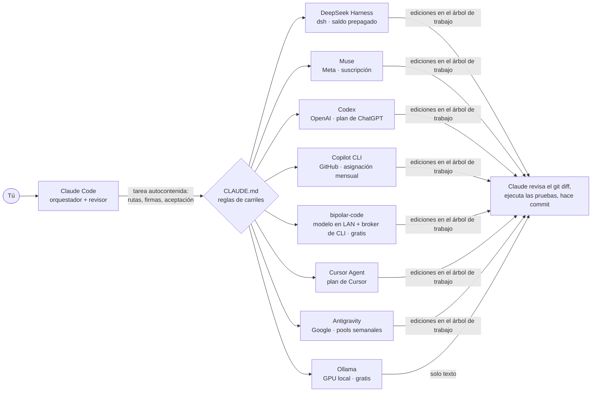
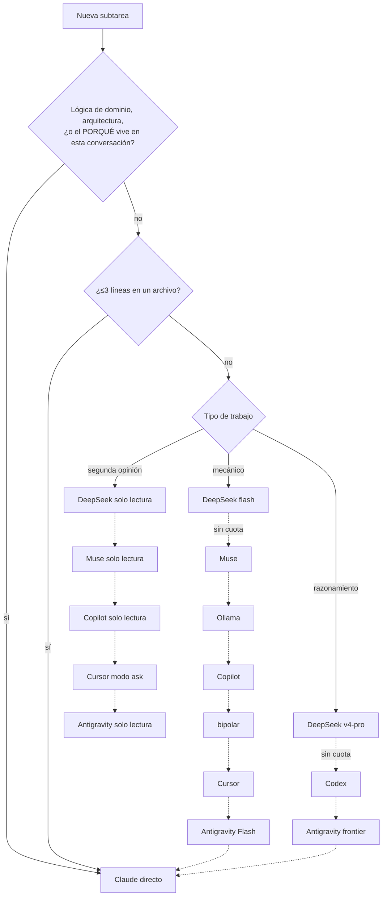
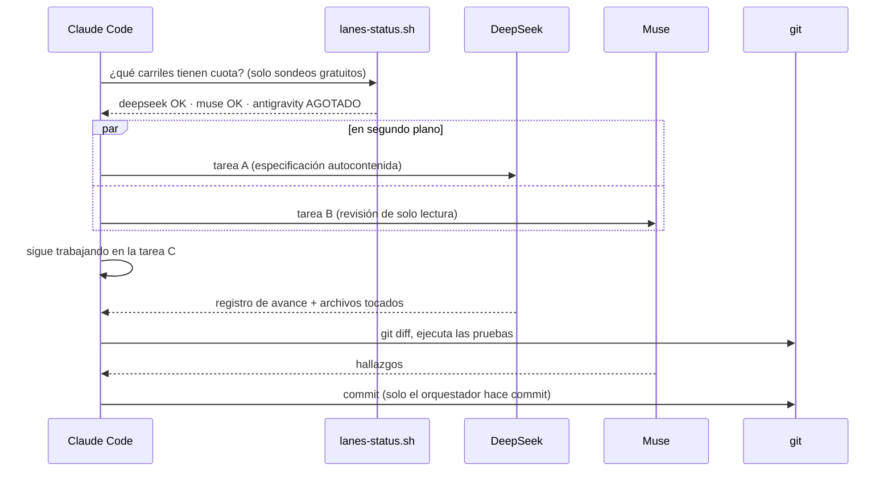

# claude-delegation-kit

*[Read in English](README.md)*

Cómo hago que Claude Code delegue la mayor parte del código a otros agentes de IA que ya pago (o que ejecuto gratis),
y reservo Claude para lo que solo él hace bien: entender el problema, escribir el contrato de cada subtarea, revisar
el diff y hacer commit. Haz un fork, elimina los carriles que no tengas y genera tus propias reglas.

- **Claude Code** es el orquestador y el revisor.
- Cada uno de los demás agentes es un **carril** (lane): un CLI ejecutado en modo headless en segundo plano mediante un pequeño plugin de Claude Code.
- Un bloque de **CLAUDE.md** le dice a Claude qué carril toma cada tipo de tarea, en qué orden y qué hacer cuando uno se queda sin cuota.
- **Meta: ≥85% de las subtareas ejecutadas por los carriles.** El resto es lo que nunca se debe delegar.

## El panorama



### Qué carril toma una tarea



### Una sesión delegada



## Los carriles

| Carril | Agente | Plugin (Claude Code) | Facturación | Ideal para | Sandbox / protecciones |
|---|---|---|---|---|---|
| deepseek | DeepSeek Harness `dsh` | [deepseek-plugin-cc](https://github.com/santiquiroz/deepseek-plugin-cc) | saldo prepagado | primer carril: mecánico (flash) y razonamiento (v4-pro) | el sandbox de dsh limita las escrituras al repositorio; escaladas headless rechazadas |
| muse | Meta Muse `muse exec` | [muse-plugin-cc](https://github.com/santiquiroz/muse-plugin-cc) | suscripción | tareas acotadas, revisiones de solo lectura (lento) | sandbox del SO de Muse, shell sin internet directo, nada autoaprobado |
| codex | OpenAI Codex CLI | [openai/codex-plugin-cc](https://github.com/openai/codex-plugin-cc) | créditos del plan de ChatGPT | corrección de builds, razonamiento multiarchivo, causa raíz | sandbox `workspace-write`, no puede escribir en `.git` |
| copilot | GitHub Copilot CLI | [copilot-plugin-cc](https://github.com/santiquiroz/copilot-plugin-cc) | asignación mensual | especificaciones, renombres, boilerplate, descripciones de PR | flags de herramientas allow/deny con alcance |
| ollama | modelo Ollama local | [ollama-plugin-cc](https://github.com/santiquiroz/ollama-plugin-cc) | gratis | texto mecánico más barato | solo texto, nunca toca archivos |
| bipolar | modelo grande en tu LAN + broker de CLI | [bipolar-plugin-cc](https://github.com/santiquiroz/bipolar-plugin-cc) · [bipolar-code](https://github.com/santiquiroz/bipolar-code) | gratis | trabajo mecánico medio; elige un carril automáticamente según la cuota | allow-list del workspace, flags fijos de seguridad por CLI |
| cursor | Cursor Agent CLI | [cursor-plugin-cc](https://github.com/santiquiroz/cursor-plugin-cc) | plan de Cursor | tareas acotadas, revisiones en modo ask | reglas deny propias del plugin |
| antigravity | Google Antigravity `agy` | [antigravity-plugin-cc](https://github.com/santiquiroz/antigravity-plugin-cc) | dos pools semanales | segundo carril frontier, Flash para trabajo mecánico | deny list global, worktree desechable para revisiones |

Las reglas de cada carril (disparadores, flags, detalles complicados) viven en [`lanes/`](lanes/). Las reglas compartidas
(regla de delegar por defecto, cómo escribir una tarea, patrón en paralelo, fallback por cuota, tareas largas) viven en [`core/rules.md`](core/rules.md).

## Uso

1. **Instala los plugins de los carriles que tengas.** En Claude Code, para cada uno:
   ```
   /plugin marketplace add santiquiroz/deepseek-plugin-cc
   /plugin install deepseek@deepseek-plugin-cc
   /deepseek:setup
   ```
2. **Lista tus carriles** en [`lanes.conf`](lanes.conf), uno por línea, en el orden en que quieres que se intenten. Elimina el resto.
3. **Genera tus reglas** e impórtalas desde tu `CLAUDE.md` global:
   ```bash
   bash scripts/build-claude-md.sh > ~/.claude/delegation.md
   echo '@delegation.md' >> ~/.claude/CLAUDE.md
   ```
   O elige carriles ad hoc: `bash scripts/build-claude-md.sh codex copilot ollama`. Las filas de "Fallback order" se generan
   a partir de tu orden y de los roles que declara cada archivo de carril.
4. **Revisa los carriles** cuando tengas dudas (sondeos gratuitos, sin gastar cuota):
   ```bash
   bash scripts/lanes-status.sh            # carriles de lanes.conf
   bash scripts/lanes-status.sh --probe-codex   # también gasta 1 turno mínimo de Codex para leer sus créditos
   ```
   Copia el script a `~/.claude/scripts/` para que las reglas puedan llamarlo desde cualquier repo.
5. **Hooks opcionales** que le dan un empujón a Claude cuando está a punto de implementar directamente: copia [`hooks/`](hooks/) a `~/.claude/hooks/`
   y fusiona [`hooks/settings.example.json`](hooks/settings.example.json) en `~/.claude/settings.json`
   (`DELEGATION_LANES`, `DELEGATION_TARGET` y `DELEGATION_LANE_PREFIXES` los personalizan).

### Agrega tu propio carril

Crea `lanes/<name>.md`. Su primera línea declara las filas que atiende, p. ej. `<!-- roles: mechanical second-opinion -->`
(`mechanical`, `reasoning`, `second-opinion`); el resto es el bloque que termina en CLAUDE.md: tabla de disparadores, flags, detalles complicados.
Agrega `<name>` a `lanes.conf`, y una función `<name>_status` a `scripts/lanes-status.sh` si tiene una forma gratuita de leer su
cuota.

## Modelo de seguridad

Los delegados editan tu árbol de trabajo con herramientas autoaprobadas, así que el kit se apoya en capas, no en confianza:

1. Cada carril corre bajo su propio sandbox o reglas deny (ver la tabla); los plugins nunca pasan los flags de "disable sandbox" o
   "approve everything" de los CLI, y se niegan cuando se les pide hacerlo.
2. Cada tarea dice: trabaja solo en este repo, sin commit/push/reset/checkout/clean, sin borrar, lista los archivos tocados.
3. Los plugins comparan los metadatos de git antes y después de cada ejecución e imprimen un WARNING cuando HEAD, la rama, el stash,
   la configuración de git o los hooks cambiaron.
4. Claude revisa `git status`, `git diff`, `git log` y `git stash list` antes de hacer commit. Solo el orquestador hace commit.

No delegues tareas que procesen contenido no confiable (páginas web, issues de desconocidos): algunos carriles tienen herramientas web.

## Lecciones aprendidas por las malas

- **Revisa la cuota antes de delegar.** Algunos CLI se cuelgan o reintentan durante minutos con un pool vacío en lugar de fallar. Un script
  de estado gratuito ahorra esos minutos; un saldo que no se puede leer gratis (DeepSeek, Muse) se trata como agotado después del primer
  error de cuota de la sesión.
- **Lee señales de cuota solo de ejecuciones fallidas.** Una ejecución exitosa cuya salida menciona "quota" no significa falta de cuota.
- **La herramienta Bash de Claude Code muere a los 10 minutos.** Un delegado eliminado ahí seguía trabajando: lanza las ejecuciones largas en
  segundo plano y retómalas en lugar de reiniciarlas.
- **Los sandboxes de Windows tienen opiniones sobre los permisos de archivos.** El shell de DeepSeek necesita una entrada explícita de control total
  para tu usuario en la carpeta del repo; el shell con sandbox de Muse se cuelga en carpetas privadas de tu usuario (p. ej. bajo `AppData`).
- **Los agentes importan tu configuración de Claude Code.** Cursor importa los hooks de `~/.claude` (que pueden bloquear cada llamada a herramientas en Windows) y
  Muse carga tus reglas personales a menos que se le diga lo contrario, lo que invita a la delegación recursiva.
- **Una ejecución con sandbox eliminada puede dejar huérfanos.** Un worker del sandbox de Muse huérfano por un timeout retuvo un lock global y rompió
  cada ejecución posterior hasta que se eliminó.
- **Ejecuta lo real antes de publicar.** Dos de los bugs corregidos aquí pasaron todas las pruebas herméticas y solo aparecieron en la primera ejecución real
  (un archivo buscado en disco que vive dentro de un archivo comprimido; un formato de credenciales asumido en lugar de leído).

## Licencia

MIT. Los plugins y bipolar-code son proyectos separados con sus propias licencias.
