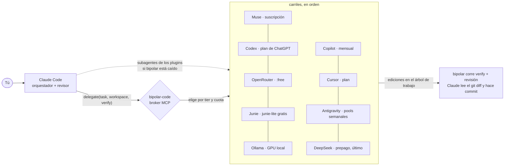
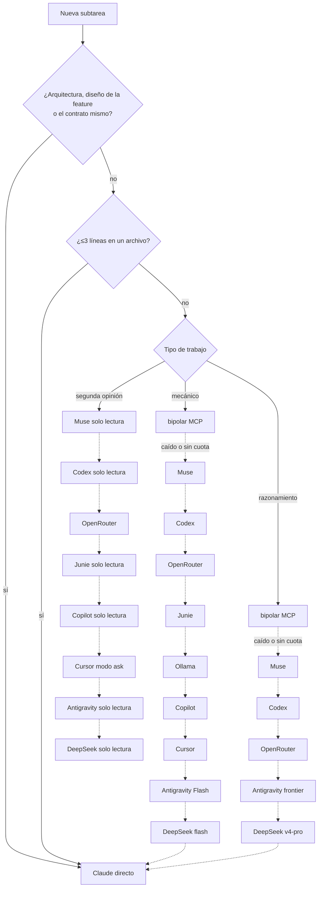
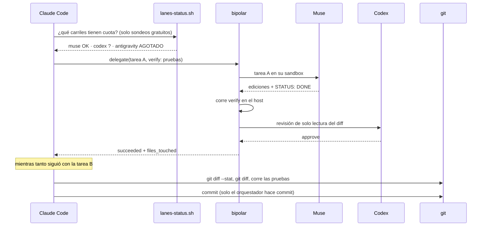

# claude-delegation-kit

*[Read in English](README.md)*

Cómo hago que Claude Code delegue la mayor parte del código a otros agentes de IA que ya pago (o que ejecuto gratis),
y reservo Claude para lo que solo él hace bien: entender el problema, escribir el contrato de cada subtarea, revisar
el diff y hacer commit. Haz un fork, elimina los carriles que no tengas y genera tus propias reglas.

- **Claude Code** es el orquestador y el revisor.
- Cada uno de los demás agentes es un **carril** (lane): un CLI ejecutado en modo headless en segundo plano.
- **bipolar-code** es la vía preferida: un broker MCP que elige el carril según la cuota, corre tus pruebas fuera de los
  sandboxes y pide una revisión de solo lectura. El plugin de Claude Code de cada carril es la ruta directa cuando bipolar está caído.
- Un bloque de **CLAUDE.md** le dice a Claude qué carril toma cada tipo de tarea, en qué orden y qué hacer cuando uno se queda sin cuota.
- **Meta: ≥90% de las subtareas ejecutadas por los carriles.** El resto es lo que nunca se debe delegar.

## El panorama



### Qué carril toma una tarea



La lógica de dominio también va a un carril, con un contrato escrito (archivos, firmas, casos borde con entradas y
salidas, pruebas que deben pasar), y Claude revisa el diff línea por línea.

### Una sesión delegada



## Los carriles

| Carril | Agente | Ruta | Facturación | Ideal para | Sandbox / protecciones |
|---|---|---|---|---|---|
| bipolar | broker MCP de bipolar-code | MCP en `/mcp` ([bipolar-code](https://github.com/santiquiroz/bipolar-code); plugin opcional [bipolar-plugin-cc](https://github.com/santiquiroz/bipolar-plugin-cc)) | gratis, autoalojado | vía preferida: elige el carril, corre `verify`, revisión de solo lectura, escalamiento | allow-list del workspace, flags fijos de seguridad por CLI, `verify` solo con `allow_request_verify` |
| muse | Meta Muse `muse exec` | [muse-plugin-cc](https://github.com/santiquiroz/muse-plugin-cc) | suscripción | primer carril: tareas acotadas, razonamiento, revisiones de solo lectura (lento) | sandbox del SO de Muse, shell sin internet directo, nada autoaprobado |
| codex | OpenAI Codex CLI | [openai/codex-plugin-cc](https://github.com/openai/codex-plugin-cc) | créditos del plan de ChatGPT | segundo carril para todo tipo de tarea: builds rotos, razonamiento multiarchivo, causa raíz, trabajo mecánico | sandbox `workspace-write`, no puede escribir en `.git` |
| openrouter | Claude Code con modelos `:free` de OpenRouter | solo por bipolar (`agent="openrouter"`) | cupo diario gratis | tareas acotadas y mecánicas cuando Muse y Codex no tienen cuota | solo modelos `:free`, allow-list propia, nada de secretos en las tareas |
| junie | JetBrains Junie CLI | [junie-plugin-cc](https://github.com/santiquiroz/junie-plugin-cc) | `junie-lite` gratis; otros modelos gastan créditos de JetBrains | tareas acotadas, revisiones de solo lectura en un worktree desechable | ninguna en Windows: autoaprueba cada comando, revisar el diff |
| ollama | modelo Ollama local | [ollama-plugin-cc](https://github.com/santiquiroz/ollama-plugin-cc) | gratis | texto mecánico más barato | solo texto, nunca toca archivos |
| copilot | GitHub Copilot CLI | [copilot-plugin-cc](https://github.com/santiquiroz/copilot-plugin-cc) | asignación mensual | especificaciones, renombres, boilerplate, descripciones de PR | flags de herramientas allow/deny con alcance |
| cursor | Cursor Agent CLI | [cursor-plugin-cc](https://github.com/santiquiroz/cursor-plugin-cc) | plan de Cursor | tareas acotadas, revisiones en modo ask | reglas deny propias del plugin |
| antigravity | Google Antigravity `agy` | [antigravity-plugin-cc](https://github.com/santiquiroz/antigravity-plugin-cc) | dos pools semanales | carril frontier, Flash para trabajo mecánico | deny list global, worktree desechable para revisiones |
| deepseek | DeepSeek Harness `dsh` | [deepseek-plugin-cc](https://github.com/santiquiroz/deepseek-plugin-cc) | saldo prepagado, pago por token | último recurso: mecánico (flash) y razonamiento (v4-pro) | el sandbox de dsh limita las escrituras al repositorio; escaladas headless rechazadas |

Las reglas de cada carril (disparadores, flags, detalles complicados) viven en [`lanes/`](lanes/). Las reglas compartidas
(regla de delegar por defecto, lógica de dominio con contrato, cómo escribir una tarea, patrón en paralelo, fallback por
cuota, tareas largas) viven en [`core/rules.md`](core/rules.md).

## Uso

1. **Instala bipolar-code (recomendado).** En Windows: clona [bipolar-code](https://github.com/santiquiroz/bipolar-code),
   corre `scripts\setup-venv.ps1`, luego `npm ci` y `npm run build` en `frontend`, y después `scripts\install-session-task.ps1`
   (arranca bipolar en tu sesión interactiva; ver [Sandboxes de Windows](#sandboxes-de-windows-una-vez-por-pc)). En su
   pestaña Agentes (o con `PUT /api/smart/config`) configura `delegation.workspace_allowlist`, `allow_request_verify` y el
   orden por tier. Registra el MCP una vez:
   ```
   claude mcp add --transport http --scope user bipolar http://127.0.0.1:8000/mcp --header "x-api-key: <UI_API_KEY>"
   ```
   `UI_API_KEY` está en el `.env` de bipolar (`C:\litellm\.env` en Windows). Nunca la pegues en un chat.
2. **Instala los plugins de los carriles que tengas.** En Claude Code, para cada uno:
   ```
   /plugin marketplace add santiquiroz/muse-plugin-cc
   /plugin install muse@muse-plugin-cc
   /muse:setup
   ```
3. **Lista tus carriles** en [`lanes.conf`](lanes.conf), uno por línea, en el orden en que quieres que se intenten. Elimina el resto.
   El orden por defecto empieza con `bipolar` (primero el MCP); `openrouter` solo funciona a través de bipolar.
4. **Genera tus reglas** e impórtalas desde tu `CLAUDE.md` global:
   ```bash
   bash scripts/build-claude-md.sh > ~/.claude/delegation.md
   echo '@delegation.md' >> ~/.claude/CLAUDE.md
   ```
   O elige carriles ad hoc: `bash scripts/build-claude-md.sh codex copilot ollama`. Las filas de "Fallback order" se generan
   a partir de tu orden y de los roles que declara cada archivo de carril.
5. **Revisa los carriles** cuando tengas dudas (sondeos gratuitos, sin gastar cuota):
   ```bash
   bash scripts/lanes-status.sh            # carriles de lanes.conf
   bash scripts/lanes-status.sh --probe-codex   # también gasta 1 turno mínimo de Codex para leer sus créditos
   ```
   También comprueba que bipolar responde y que la clave de OpenRouter es válida, sin gastar requests; las dos claves se
   leen del `.env` de bipolar y nunca se imprimen. Copia el script a `~/.claude/scripts/` y `lanes.conf` a `~/.claude/`
   para que las reglas puedan llamarlo desde cualquier repo.
6. **Hooks opcionales** que le dan un empujón a Claude cuando está a punto de implementar directamente: copia [`hooks/`](hooks/) a `~/.claude/hooks/`
   y fusiona [`hooks/settings.example.json`](hooks/settings.example.json) en `~/.claude/settings.json`
   (`DELEGATION_LANES`, `DELEGATION_TARGET` y `DELEGATION_LANE_PREFIXES` los personalizan).

### Sandboxes de Windows (una vez por PC)

- Trabaja en una carpeta como `C:\proyectos`, nunca bajo `%USERPROFILE%\AppData` ni en una carpeta de OneDrive: el shell
  aislado de Muse se cuelga ahí sin mostrar ningún error.
- **Muse:** corre `muse sandbox windows setup` en PowerShell como administrador hasta que `muse sandbox windows check` diga
  `status=ready`. Crea dos cuentas locales restringidas y el grupo `MuseSandboxUsers`; los comandos del agente corren con
  esas cuentas y solo pueden tocar el workspace.
- Después dale a ese grupo permiso de escritura en tu carpeta Temp. Solo hereda lectura, así que los builds fallan con
  `UnauthorizedAccessException` o el shell se cuelga: `icacls "$env:LOCALAPPDATA\Temp" /grant "MuseSandboxUsers:(OI)(CI)M"`
  (se revierte con `/remove:g MuseSandboxUsers`).
- El sandbox de Muse no puede correr nada que abra sockets locales (`dotnet test`, `ng test`, `npx`): pon esos comandos en
  el `verify` de bipolar.
- **DeepSeek Harness** necesita una entrada explícita de control total para tu usuario en el workspace:
  `icacls C:\proyectos /grant "$($env:USERNAME):(OI)(CI)F"`.
- **Codex:** mantén la CLI al día (`npm i -g @openai/codex@latest`). La app de escritorio escribe en `~/.codex/config.toml`
  un modelo que una CLI vieja rechaza o con el que se cuelga. Diagnostica con
  `codex exec --ignore-user-config --skip-git-repo-check -s read-only "Reply with exactly: ok"`.
- **bipolar** debe correr en tu sesión interactiva: en la sesión 0 (un servicio o una tarea programada con contraseña) los
  sandboxes de Muse y Codex no arrancan y el broker los descarta con `sandbox_requires_interactive_session`.

### Libera la GPU para juegos y editores (Ollama)

[`scripts/ollama-guard.ps1`](scripts/ollama-guard.ps1) detiene Ollama mientras corre un juego o un programa de edición y lo
vuelve a abrir 20 segundos después de cerrarlo; luego le avisa a claude-mem que retome su cola. Revisa cada 5 segundos contra
[`scripts/ollama-guard.rules.txt`](scripts/ollama-guard.rules.txt): carpetas de tiendas (Steam, Epic, Xbox, Riot, Ubisoft,
GOG, EA), ejecutables de editores y exclusiones con `!` para programas que viven en esas carpetas pero quedan abiertos
(overlays, fondos animados). Copia los dos archivos a una carpeta tuya y luego:

```powershell
powershell -ExecutionPolicy Bypass -File ollama-guard.ps1 -Check     # qué coincide ahora: debe ser none
powershell -ExecutionPolicy Bypass -File ollama-guard.ps1 -Install   # tarea al iniciar sesión, sin administrador
powershell -ExecutionPolicy Bypass -File ollama-guard.ps1 -Uninstall
```

`-Install` se niega mientras algo coincida: un programa que queda siempre abierto en la lista dejaría Ollama parado para
siempre. [Corral](https://github.com/santiquiroz/corral) es la app de bandeja para pausar a mano y ver la VRAM de cada modelo.

### Configura un PC nuevo con un solo prompt

[`docs/setup-prompt.es.md`](docs/setup-prompt.es.md) es un prompt para pegar en Claude Code en un PC con Windows recién
instalado. Hace el inventario de los CLI, arregla los sandboxes, monta Ollama con claude-mem y el guardián, instala los plugins y bipolar, genera las reglas con este
kit y termina con una prueba de delegación de punta a punta. Los inicios de sesión, las ventanas de administrador y las
claves de API quedan en tus manos.

### Agrega tu propio carril

Crea `lanes/<name>.md`. Su primera línea declara las filas que atiende, p. ej. `<!-- roles: mechanical second-opinion -->`
(`mechanical`, `reasoning`, `second-opinion`); el resto es el bloque que termina en CLAUDE.md: tabla de disparadores, flags, detalles complicados.
Agrega `<name>` a `lanes.conf`, y una función `<name>_status` a `scripts/lanes-status.sh` si tiene una forma gratuita de leer su
cuota. Un carril también puede ser un agente del broker de bipolar (como `openrouter`), usado con `delegate(..., agent="<id>")`.

## Modelo de seguridad

Los delegados editan tu árbol de trabajo con herramientas autoaprobadas, así que el kit se apoya en capas, no en confianza:

1. Cada carril corre bajo su propio sandbox o reglas deny (ver la tabla); los plugins nunca pasan los flags de "disable sandbox" o
   "approve everything" de los CLI, y se niegan cuando se les pide hacerlo.
2. Cada tarea dice: trabaja solo en este repo, sin commit/push/reset/checkout/clean, sin borrar, lista los archivos tocados.
3. Los plugins comparan los metadatos de git antes y después de cada ejecución e imprimen un WARNING cuando HEAD, la rama, el stash,
   la configuración de git o los hooks cambiaron.
4. Claude revisa `git status`, `git diff --stat`, `git diff`, `git log` y `git stash list` antes de hacer commit. Solo el
   orquestador hace commit.
5. El `verify` de bipolar corre fuera de todo sandbox con tu usuario y ejecuta código que el delegado pudo cambiar: activa
   `allow_request_verify` solo para tus propios repos.
6. Los modelos gratis de OpenRouter pueden guardar los prompts: nunca le mandes secretos ni datos personales a ese carril.

No delegues tareas que procesen contenido no confiable (páginas web, issues de desconocidos): algunos carriles tienen herramientas web.

## Lecciones aprendidas por las malas

- **Revisa la cuota antes de delegar.** Algunos CLI se cuelgan o reintentan durante minutos con un pool vacío en lugar de fallar. Un script
  de estado gratuito ahorra esos minutos; un saldo que no se puede leer gratis (Muse, DeepSeek) se trata como agotado después del primer
  error de cuota de la sesión.
- **"OK" no es cuota.** Los carriles sin medidor gratuito (Muse, Copilot, Cursor) pueden responder 429 en la primera ejecución real.
  Pasa al siguiente carril con el primer error de cuota en lugar de esperar.
- **Lee señales de cuota solo de ejecuciones fallidas.** Una ejecución exitosa cuya salida menciona "quota" no significa falta de cuota.
- **Un carril que se queda sin cuota a mitad de camino puede dejar archivos vacíos** y aun así decir que terminó. Revisa
  `git diff --stat` en busca de borrados masivos antes de confiar en una ejecución.
- **La herramienta Bash de Claude Code muere a los 10 minutos.** Un delegado eliminado ahí seguía trabajando: lanza las ejecuciones largas en
  segundo plano y retómalas en lugar de reiniciarlas.
- **Los sandboxes de Windows tienen opiniones sobre los permisos de archivos.** El shell de DeepSeek necesita una entrada explícita de control total
  para tu usuario en la carpeta del repo; el shell con sandbox de Muse se cuelga en carpetas privadas de tu usuario (p. ej. bajo `AppData`)
  y necesita permiso de escritura en tu carpeta Temp para compilar.
- **La sesión 0 de Windows rompe los sandboxes.** Un broker arrancado como servicio no puede correr Muse ni Codex.
- **Los agentes importan tu configuración de Claude Code.** Cursor importa los hooks de `~/.claude` (que pueden bloquear cada llamada a herramientas en Windows) y
  Muse carga tus reglas personales a menos que se le diga lo contrario, lo que invita a la delegación recursiva.
- **Junie en Windows no tiene sandbox** y autoaprueba cada comando: úsalo solo en repos propios y revisa el diff.
- **Una ejecución con sandbox eliminada puede dejar huérfanos.** Un worker del sandbox de Muse huérfano por un timeout retuvo un lock global y rompió
  cada ejecución posterior hasta que se eliminó.
- **Los disparadores por proceso chocan con programas que nunca se cierran.** La primera ejecución real del guardián de Ollama
  encontró un overlay de Epic, una mascota de escritorio y un crash handler de Unity siempre abiertos, que lo habrían dejado
  parado. Por eso existen `-Check` y un instalador que se niega mientras algo coincida.
- **Ejecuta lo real antes de publicar.** Dos de los bugs corregidos aquí pasaron todas las pruebas herméticas y solo aparecieron en la primera ejecución real
  (un archivo buscado en disco que vive dentro de un archivo comprimido; un formato de credenciales asumido en lugar de leído).

## Licencia

MIT. Los plugins y bipolar-code son proyectos separados con sus propias licencias.
