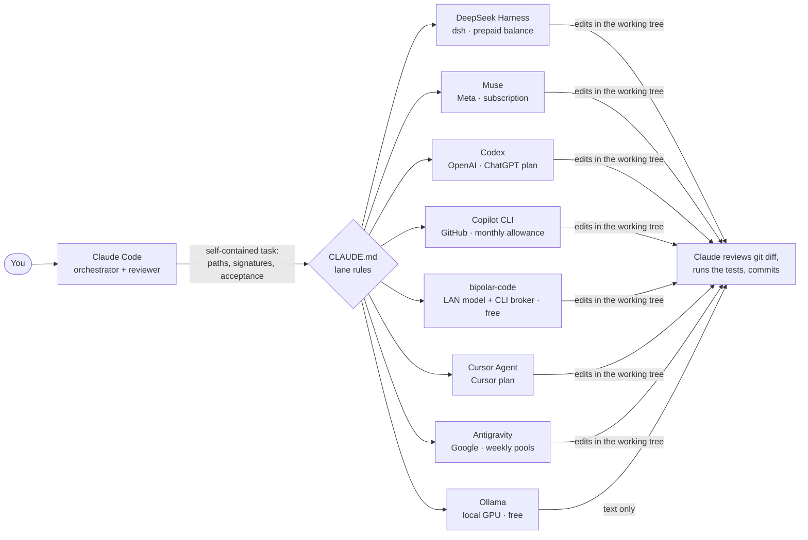
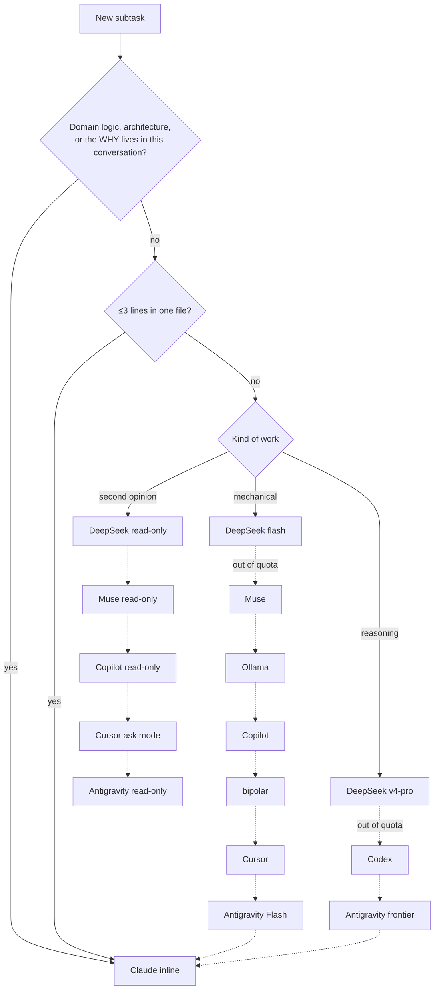
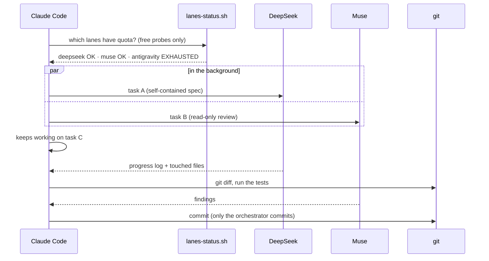

# claude-delegation-kit

*[Leer en español](README.es.md)*

How I make Claude Code delegate most of the coding to other AI agents I already pay for (or run for free), and keep
Claude for what only it does well: understanding the problem, writing the contract of each subtask, reviewing the diff and
committing. Fork it, delete the lanes you don't have, and generate your own rules.

- **Claude Code** is the orchestrator and the reviewer.
- Every other agent is a **lane**: a CLI run headless in the background through a small Claude Code plugin.
- A **CLAUDE.md** block tells Claude which lane takes each kind of task, in which order, and what to do when one runs out.
- **Target: ≥85% of subtasks executed by lanes.** The rest is what should never be delegated.

## The picture



### Which lane takes a task



### One delegated session



## The lanes

| Lane | Agent | Plugin (Claude Code) | Billing | Best for | Sandbox / guardrails |
|---|---|---|---|---|---|
| deepseek | DeepSeek Harness `dsh` | [deepseek-plugin-cc](https://github.com/santiquiroz/deepseek-plugin-cc) | prepaid balance | first lane: mechanical (flash) and reasoning (v4-pro) | dsh sandbox confines writes to the repo; headless escalations refused |
| muse | Meta Muse `muse exec` | [muse-plugin-cc](https://github.com/santiquiroz/muse-plugin-cc) | subscription | bounded tasks, read-only reviews (slow) | Muse OS sandbox, shell without direct internet, nothing auto-approved |
| codex | OpenAI Codex CLI | [openai/codex-plugin-cc](https://github.com/openai/codex-plugin-cc) | ChatGPT plan credits | build fixes, multi-file reasoning, root cause | `workspace-write` sandbox, cannot write `.git` |
| copilot | GitHub Copilot CLI | [copilot-plugin-cc](https://github.com/santiquiroz/copilot-plugin-cc) | monthly allowance | specs, renames, boilerplate, PR descriptions | scoped allow/deny tool flags |
| ollama | local Ollama model | [ollama-plugin-cc](https://github.com/santiquiroz/ollama-plugin-cc) | free | cheapest mechanical text | text only, never touches files |
| bipolar | big model on your LAN + CLI broker | [bipolar-plugin-cc](https://github.com/santiquiroz/bipolar-plugin-cc) · [bipolar-code](https://github.com/santiquiroz/bipolar-code) | free | medium mechanical work; auto-picks a lane by quota | workspace allow-list, per-CLI fixed safety flags |
| cursor | Cursor Agent CLI | [cursor-plugin-cc](https://github.com/santiquiroz/cursor-plugin-cc) | Cursor plan | bounded tasks, ask-mode reviews | plugin-owned deny rules |
| antigravity | Google Antigravity `agy` | [antigravity-plugin-cc](https://github.com/santiquiroz/antigravity-plugin-cc) | two weekly pools | frontier second lane, Flash for mechanical | global deny list, disposable worktree for reviews |

Each lane's rules (triggers, flags, gotchas) live in [`lanes/`](lanes/). The shared rules (default-delegate rule, how to
write a task, parallel pattern, quota fallback, long tasks) live in [`core/rules.md`](core/rules.md).

## Use it

1. **Install the plugins of the lanes you have.** In Claude Code, for each one:
   ```
   /plugin marketplace add santiquiroz/deepseek-plugin-cc
   /plugin install deepseek@deepseek-plugin-cc
   /deepseek:setup
   ```
2. **List your lanes** in [`lanes.conf`](lanes.conf), one per line, in the order you want them tried. Delete the rest.
3. **Generate your rules** and import them from your global `CLAUDE.md`:
   ```bash
   bash scripts/build-claude-md.sh > ~/.claude/delegation.md
   echo '@delegation.md' >> ~/.claude/CLAUDE.md
   ```
   Or pick lanes ad hoc: `bash scripts/build-claude-md.sh codex copilot ollama`. The "Fallback order" rows are generated
   from your order and from the roles each lane file declares.
4. **Check the lanes** whenever you are in doubt (free probes, no quota spent):
   ```bash
   bash scripts/lanes-status.sh            # lanes from lanes.conf
   bash scripts/lanes-status.sh --probe-codex   # also spends 1 minimal Codex turn to read its credits
   ```
   Copy the script to `~/.claude/scripts/` so the rules can call it from any repo.
5. **Optional hooks** that nudge Claude when it is about to implement inline: copy [`hooks/`](hooks/) to `~/.claude/hooks/`
   and merge [`hooks/settings.example.json`](hooks/settings.example.json) into `~/.claude/settings.json`
   (`DELEGATION_LANES`, `DELEGATION_TARGET` and `DELEGATION_LANE_PREFIXES` customize them).

### Add a lane of your own

Create `lanes/<name>.md`. Its first line declares the rows it serves, e.g. `<!-- roles: mechanical second-opinion -->`
(`mechanical`, `reasoning`, `second-opinion`); the rest is the block that lands in CLAUDE.md: trigger table, flags, gotchas.
Add `<name>` to `lanes.conf`, and a `<name>_status` function to `scripts/lanes-status.sh` if it has a free way to read its
quota.

## Safety model

Delegates edit your working tree with tools auto-approved, so the kit relies on layers, not on trust:

1. Each lane runs under its own sandbox or deny rules (see the table); the plugins never pass the CLIs' "disable sandbox" or
   "approve everything" flags, and refuse when asked to.
2. Every task says: work only in this repo, no commit/push/reset/checkout/clean, no deleting, list the touched files.
3. The plugins compare git metadata before and after each run and print a WARNING when HEAD, the branch, the stash, the git
   config or the hooks changed.
4. Claude reviews `git status`, `git diff`, `git log` and `git stash list` before committing. Only the orchestrator commits.

Do not delegate tasks that process untrusted content (web pages, issues from strangers): some lanes have web tools.

## Lessons learned the hard way

- **Check quota before delegating.** Some CLIs hang or retry for minutes on an empty pool instead of failing. A free status
  script saves those minutes; a balance you cannot read for free (DeepSeek, Muse) is treated as exhausted after the first
  quota error of the session.
- **Only read quota signals from failed runs.** A successful run whose output talks about "quota" is not out of quota.
- **Claude Code's Bash tool dies at 10 minutes.** A delegate killed there was still working: launch long runs in the
  background and resume them instead of restarting.
- **Windows sandboxes have opinions about file permissions.** DeepSeek's shell needs an explicit full-control entry for your
  user on the repo folder; Muse's sandboxed shell hangs in folders private to your user (e.g. under `AppData`).
- **Agents import your Claude Code setup.** Cursor imports `~/.claude` hooks (which can block every tool call on Windows) and
  Muse loads your personal rules unless told not to, which invites recursive delegation.
- **A killed sandboxed run can leave orphans.** A Muse sandbox worker orphaned by a timeout held a global lock and broke
  every later run until it was killed.
- **Run the real thing before publishing.** Two of the bugs fixed here passed every hermetic test and only showed up on the
  first real run (a file looked up on disk that lives inside an archive; a credentials format assumed instead of read).

## License

MIT. The plugins and bipolar-code are separate projects with their own licenses.
