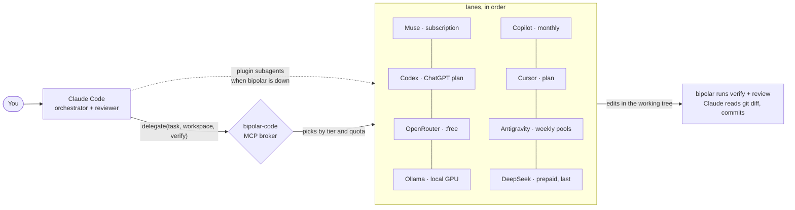
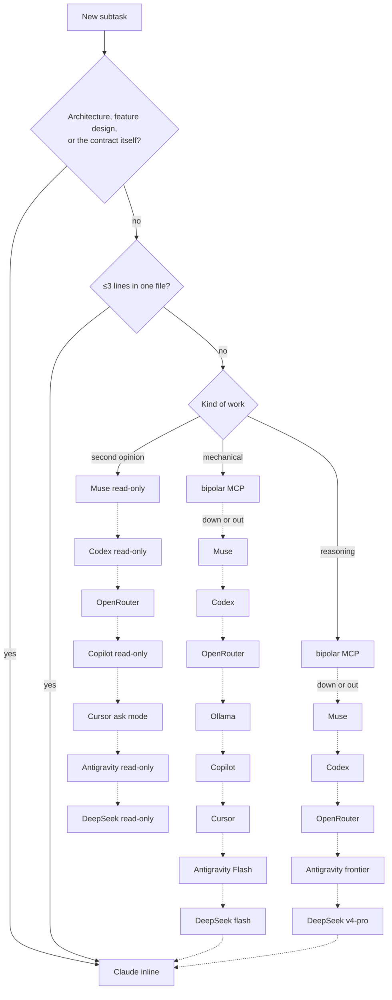
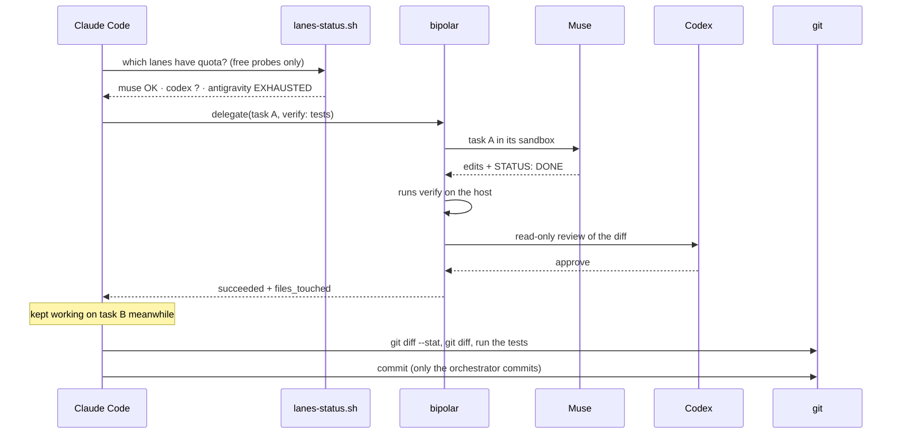

# claude-delegation-kit

*[Leer en español](README.es.md)*

How I make Claude Code delegate most of the coding to other AI agents I already pay for (or run for free), and keep
Claude for what only it does well: understanding the problem, writing the contract of each subtask, reviewing the diff and
committing. Fork it, delete the lanes you don't have, and generate your own rules.

- **Claude Code** is the orchestrator and the reviewer.
- Every other agent is a **lane**: a CLI run headless in the background.
- **bipolar-code** is the preferred path: an MCP broker that picks the lane by quota, runs your tests outside the
  sandboxes and asks a read-only reviewer. The Claude Code plugin of each lane is the direct route when it is down.
- A **CLAUDE.md** block tells Claude which lane takes each kind of task, in which order, and what to do when one runs out.
- **Target: ≥90% of subtasks executed by lanes.** The rest is what should never be delegated.

## The picture



### Which lane takes a task



Domain logic goes to a lane too, with a written contract (files, signatures, edge cases with inputs and outputs, tests
that must pass), and Claude reviews the diff line by line.

### One delegated session



## The lanes

| Lane | Agent | Route | Billing | Best for | Sandbox / guardrails |
|---|---|---|---|---|---|
| bipolar | bipolar-code MCP broker | MCP at `/mcp` ([bipolar-code](https://github.com/santiquiroz/bipolar-code); optional plugin [bipolar-plugin-cc](https://github.com/santiquiroz/bipolar-plugin-cc)) | free, self-hosted | preferred path: picks the lane, runs `verify`, read-only review, escalation | workspace allow-list, fixed safety flags per CLI, `verify` only with `allow_request_verify` |
| muse | Meta Muse `muse exec` | [muse-plugin-cc](https://github.com/santiquiroz/muse-plugin-cc) | subscription | first lane: bounded tasks, reasoning, read-only reviews (slow) | Muse OS sandbox, shell without direct internet, nothing auto-approved |
| codex | OpenAI Codex CLI | [openai/codex-plugin-cc](https://github.com/openai/codex-plugin-cc) | ChatGPT plan credits | second lane for every kind of task: build fixes, multi-file reasoning, root cause, mechanical work | `workspace-write` sandbox, cannot write `.git` |
| openrouter | Claude Code on OpenRouter `:free` models | through bipolar only (`agent="openrouter"`) | free daily allowance | bounded and mechanical tasks when Muse and Codex are out | `:free` models only, own workspace allow-list, no secrets in tasks |
| ollama | local Ollama model | [ollama-plugin-cc](https://github.com/santiquiroz/ollama-plugin-cc) | free | cheapest mechanical text | text only, never touches files |
| copilot | GitHub Copilot CLI | [copilot-plugin-cc](https://github.com/santiquiroz/copilot-plugin-cc) | monthly allowance | specs, renames, boilerplate, PR descriptions | scoped allow/deny tool flags |
| cursor | Cursor Agent CLI | [cursor-plugin-cc](https://github.com/santiquiroz/cursor-plugin-cc) | Cursor plan | bounded tasks, ask-mode reviews | plugin-owned deny rules |
| antigravity | Google Antigravity `agy` | [antigravity-plugin-cc](https://github.com/santiquiroz/antigravity-plugin-cc) | two weekly pools | frontier lane, Flash for mechanical | global deny list, disposable worktree for reviews |
| deepseek | DeepSeek Harness `dsh` | [deepseek-plugin-cc](https://github.com/santiquiroz/deepseek-plugin-cc) | prepaid balance, pay per token | last resort: mechanical (flash) and reasoning (v4-pro) | dsh sandbox confines writes to the repo; headless escalations refused |

Each lane's rules (triggers, flags, gotchas) live in [`lanes/`](lanes/). The shared rules (default-delegate rule, domain
logic with a contract, how to write a task, parallel pattern, quota fallback, long tasks) live in
[`core/rules.md`](core/rules.md).

## Use it

1. **Install bipolar-code (recommended).** On Windows: clone [bipolar-code](https://github.com/santiquiroz/bipolar-code),
   run `scripts\setup-venv.ps1`, then `npm ci` and `npm run build` in `frontend`, then `scripts\install-session-task.ps1`
   (it starts bipolar in your interactive session; see [Windows sandboxes](#windows-sandboxes-once-per-pc)). In its Agents
   tab (or `PUT /api/smart/config`) set `delegation.workspace_allowlist`, `allow_request_verify` and the tier order.
   Register the MCP once:
   ```
   claude mcp add --transport http --scope user bipolar http://127.0.0.1:8000/mcp --header "x-api-key: <UI_API_KEY>"
   ```
   `UI_API_KEY` lives in bipolar's `.env` (`C:\litellm\.env` on Windows). Never paste it in a chat.
2. **Install the plugins of the lanes you have.** In Claude Code, for each one:
   ```
   /plugin marketplace add santiquiroz/muse-plugin-cc
   /plugin install muse@muse-plugin-cc
   /muse:setup
   ```
3. **List your lanes** in [`lanes.conf`](lanes.conf), one per line, in the order you want them tried. Delete the rest.
   The default order starts with `bipolar` (MCP first); `openrouter` works only through bipolar.
4. **Generate your rules** and import them from your global `CLAUDE.md`:
   ```bash
   bash scripts/build-claude-md.sh > ~/.claude/delegation.md
   echo '@delegation.md' >> ~/.claude/CLAUDE.md
   ```
   Or pick lanes ad hoc: `bash scripts/build-claude-md.sh codex copilot ollama`. The "Fallback order" rows are generated
   from your order and from the roles each lane file declares.
5. **Check the lanes** whenever you are in doubt (free probes, no quota spent):
   ```bash
   bash scripts/lanes-status.sh            # lanes from lanes.conf
   bash scripts/lanes-status.sh --probe-codex   # also spends 1 minimal Codex turn to read its credits
   ```
   It also checks that bipolar answers and that the OpenRouter key is valid, without spending requests; both keys are read
   from bipolar's `.env` and never printed. Copy the script to `~/.claude/scripts/` and `lanes.conf` to `~/.claude/` so the
   rules can call it from any repo.
6. **Optional hooks** that nudge Claude when it is about to implement inline: copy [`hooks/`](hooks/) to `~/.claude/hooks/`
   and merge [`hooks/settings.example.json`](hooks/settings.example.json) into `~/.claude/settings.json`
   (`DELEGATION_LANES`, `DELEGATION_TARGET` and `DELEGATION_LANE_PREFIXES` customize them).

### Windows sandboxes (once per PC)

- Work in a folder like `C:\projects`, never under `%USERPROFILE%\AppData` or a OneDrive folder: Muse's sandboxed shell
  hangs there with no error.
- **Muse:** run `muse sandbox windows setup` in an elevated PowerShell until `muse sandbox windows check` says
  `status=ready`. It creates two restricted local accounts and the `MuseSandboxUsers` group; the agent's commands run as
  them and can only touch the workspace.
- Then give that group write access to your Temp folder. It only inherits read, so builds fail with
  `UnauthorizedAccessException` or the shell hangs: `icacls "$env:LOCALAPPDATA\Temp" /grant "MuseSandboxUsers:(OI)(CI)M"`
  (undo with `/remove:g MuseSandboxUsers`).
- Muse's sandbox cannot run anything that opens local sockets (`dotnet test`, `ng test`, `npx`): put those commands in
  bipolar's `verify`.
- **DeepSeek Harness** needs an explicit full-control entry for your user on the workspace:
  `icacls C:\projects /grant "$($env:USERNAME):(OI)(CI)F"`.
- **Codex:** keep the CLI current (`npm i -g @openai/codex@latest`). The desktop app writes a model into
  `~/.codex/config.toml` that an old CLI rejects or hangs on. Diagnose with
  `codex exec --ignore-user-config --skip-git-repo-check -s read-only "Reply with exactly: ok"`.
- **bipolar** must run in your interactive session: in session 0 (a service or a password-based scheduled task) the Muse
  and Codex sandboxes cannot start and the broker skips them with `sandbox_requires_interactive_session`.

### Free the GPU for games and editors (Ollama)

[`scripts/ollama-guard.ps1`](scripts/ollama-guard.ps1) stops Ollama while a game or an editing program runs and starts it
again 20 seconds after it closes, then tells claude-mem to resume its queue. It checks every 5 seconds against
[`scripts/ollama-guard.rules.txt`](scripts/ollama-guard.rules.txt): store folders (Steam, Epic, Xbox, Riot, Ubisoft, GOG,
EA), editor executables, and `!` exclusions for helpers that live in those folders but stay open (overlays, animated
wallpapers). Copy both files somewhere of your own, then:

```powershell
powershell -ExecutionPolicy Bypass -File ollama-guard.ps1 -Check     # what matches right now: must be none
powershell -ExecutionPolicy Bypass -File ollama-guard.ps1 -Install   # logon task in your session, no admin
powershell -ExecutionPolicy Bypass -File ollama-guard.ps1 -Uninstall
```

`-Install` refuses while something matches: an always-on helper in the list would keep Ollama stopped forever.
[Corral](https://github.com/santiquiroz/corral) is the tray app for pausing by hand and watching VRAM per model.

### Set up a new PC with one prompt

[`docs/setup-prompt.es.md`](docs/setup-prompt.es.md) (Spanish) is a prompt to paste into Claude Code on a fresh Windows
PC. It inventories the CLIs, fixes the sandboxes, sets up Ollama with claude-mem and the guard, installs the plugins and bipolar, generates the rules from this kit and
ends with an end-to-end delegation test. Logins, UAC prompts and API keys stay with you.

### Add a lane of your own

Create `lanes/<name>.md`. Its first line declares the rows it serves, e.g. `<!-- roles: mechanical second-opinion -->`
(`mechanical`, `reasoning`, `second-opinion`); the rest is the block that lands in CLAUDE.md: trigger table, flags, gotchas.
Add `<name>` to `lanes.conf`, and a `<name>_status` function to `scripts/lanes-status.sh` if it has a free way to read its
quota. A lane can also be an agent of the bipolar broker (like `openrouter`), used through `delegate(..., agent="<id>")`.

## Safety model

Delegates edit your working tree with tools auto-approved, so the kit relies on layers, not on trust:

1. Each lane runs under its own sandbox or deny rules (see the table); the plugins never pass the CLIs' "disable sandbox" or
   "approve everything" flags, and refuse when asked to.
2. Every task says: work only in this repo, no commit/push/reset/checkout/clean, no deleting, list the touched files.
3. The plugins compare git metadata before and after each run and print a WARNING when HEAD, the branch, the stash, the git
   config or the hooks changed.
4. Claude reviews `git status`, `git diff --stat`, `git diff`, `git log` and `git stash list` before committing. Only the
   orchestrator commits.
5. bipolar's `verify` runs outside every sandbox with your user and executes code the delegate could have changed: enable
   `allow_request_verify` only for your own repos.
6. OpenRouter's free models may store prompts: never send secrets or personal data to that lane.

Do not delegate tasks that process untrusted content (web pages, issues from strangers): some lanes have web tools.

## Lessons learned the hard way

- **Check quota before delegating.** Some CLIs hang or retry for minutes on an empty pool instead of failing. A free status
  script saves those minutes; a balance you cannot read for free (Muse, DeepSeek) is treated as exhausted after the first
  quota error of the session.
- **"OK" is not quota.** Lanes without a free meter (Muse, Copilot, Cursor) can answer 429 on the first real run. Move on at
  the first quota error instead of waiting.
- **Only read quota signals from failed runs.** A successful run whose output talks about "quota" is not out of quota.
- **A lane that runs out mid-run can leave files empty** and still report it finished. Check `git diff --stat` for mass
  deletions before trusting a run.
- **Claude Code's Bash tool dies at 10 minutes.** A delegate killed there was still working: launch long runs in the
  background and resume them instead of restarting.
- **Windows sandboxes have opinions about file permissions.** DeepSeek's shell needs an explicit full-control entry for your
  user on the repo folder; Muse's sandboxed shell hangs in folders private to your user (e.g. under `AppData`) and needs
  write access to your Temp folder to build.
- **Windows session 0 breaks the sandboxes.** A broker started as a service cannot run Muse or Codex.
- **Agents import your Claude Code setup.** Cursor imports `~/.claude` hooks (which can block every tool call on Windows) and
  Muse loads your personal rules unless told not to, which invites recursive delegation.
- **A killed sandboxed run can leave orphans.** A Muse sandbox worker orphaned by a timeout held a global lock and broke
  every later run until it was killed.
- **Process-based triggers meet always-on helpers.** The first live run of the Ollama guard matched an Epic overlay, a desktop
  pet and a Unity crash handler that never close, and would have kept Ollama stopped. Hence `-Check` and an install that
  refuses while anything matches.
- **Run the real thing before publishing.** Two of the bugs fixed here passed every hermetic test and only showed up on the
  first real run (a file looked up on disk that lives inside an archive; a credentials format assumed instead of read).

## License

MIT. The plugins and bipolar-code are separate projects with their own licenses.
